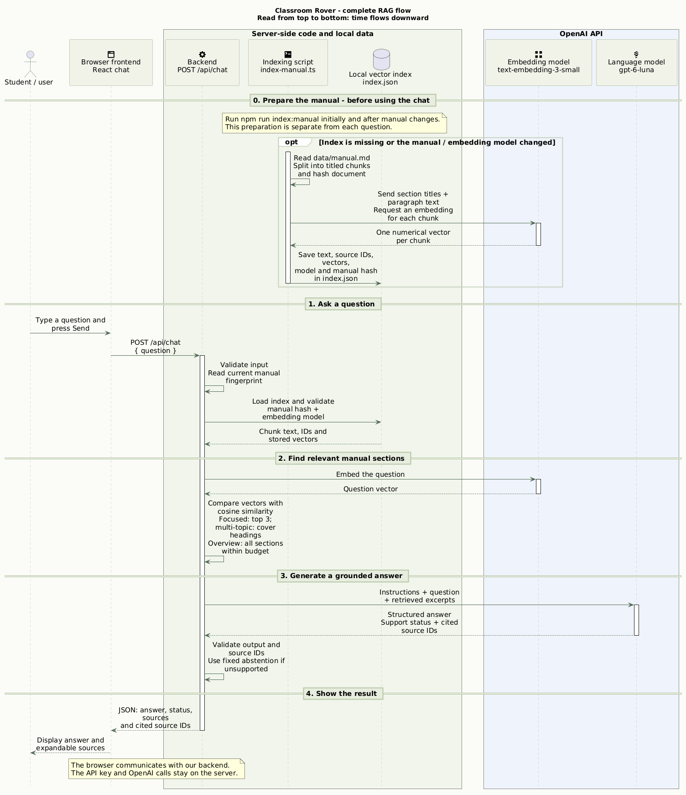

# Classroom Rover — Robot Manual Chat

A small RAG application that answers questions using a fictional educational robot manual. Built for the [original technical assignment](ORIGINAL_TASK.md) with Next.js, TypeScript, Tailwind CSS, and the OpenAI SDK.

The interface displays generated answers and expandable manual excerpts, marks cited sources, and distinguishes supported, partial, and unsupported answers. It includes a browsable manual, example questions, loading/error states, and a 400-character question limit. The layout supports desktop and phone screens.

## Run locally

Requirements: a Node.js version supported by the installed Next.js release (Node 20.9 or newer), npm, and an OpenAI API key with available API credit and access to the configured models. Installation needs access to the npm registry; indexing and chat need access to OpenAI.

From the extracted `robot-manual-rag` directory:

```sh
npm ci
cp .env.example .env.local
```

Enter your key in `.env.local`:

```dotenv
OPENAI_API_KEY=your_key_here
OPENAI_EMBEDDING_MODEL=text-embedding-3-small
OPENAI_CHAT_MODEL=gpt-6-luna
```

Then prepare the index and start the app:

```sh
npm run index:manual
npm run dev
```

Open the Local URL printed by Next.js, normally http://127.0.0.1:3000. Stop the server with Ctrl+C. To inspect chunking without making an API request, run `npm run index:manual -- --dry-run`.

The submission excludes `.env.local`, `data/index.json`, installed dependencies, and build output. Create your own environment file and generate the index before asking questions. Never prefix the key with `NEXT_PUBLIC_`; credentials stay in server/CLI code.

For a production run:

```sh
npm run build
npm start
```

Stop an existing server first, or choose a different port. If Turbopack cannot open an internal worker port in a restricted environment, build with `npm run build -- --webpack` instead, then run `npm start`. On macOS/Linux, `WATCHPACK_POLLING=true npm run dev` is available when native file watching is unavailable.

## Architecture

Step 0 prepares the manual. Steps 1–4 follow one question from submission to its displayed answer. Each component has a column; time flows downward.



| Component | Purpose and implementation |
| --- | --- |
| Frontend | React chat and manual viewer in `src/components/chat.tsx`; sends questions to our backend and displays answers and sources. |
| Backend | Next.js `POST /api/chat`; validates questions, coordinates retrieval and generation, and returns safe errors. |
| Document processing | `src/lib/document.ts` parses numbered Markdown sections and calculates a source-file hash. |
| Embeddings | OpenAI `text-embedding-3-small` converts manual chunks and questions into comparable vectors. |
| Vector storage | Local `data/index.json` stores chunk text, IDs, vectors, model information, and the manual hash. No dedicated vector database is needed for ten chunks. |
| Retrieval | `src/lib/similarity.ts` calculates cosine similarity; `src/lib/retrieval.ts` selects context with embedding ranking, explicit topic coverage, and a character budget. |
| LLM and validation | `src/lib/generation.ts` calls OpenAI Responses; `src/lib/answer.ts` assembles context-only instructions and validates answer status and cited source IDs. |

Also included: a [component overview](docs/architecture-overview.png) and a [detailed indexing sequence](docs/indexing-flow.png). All diagrams have editable PlantUML sources in `docs/`. Paste [architecture.puml](docs/architecture.puml) into [PlantText](https://www.planttext.com/) and select **Save & Refresh** to edit the main diagram; `docs/planttext-link.txt` contains a preloaded editor link.

## How the RAG pipeline works

**Indexing:** `scripts/index-manual.ts` reads the ten-section manual, sends section titles and text in one embedding batch, and writes the resulting index atomically. One complete, self-contained paragraph forms one chunk, so this document does not need overlap. An unchanged manual and embedding model reuse the existing index without another API call.

**Answering:** the backend embeds the question, ranks all stored vectors by cosine similarity, and selects context using `src/lib/context-selection.ts`. Focused questions keep the top three embedding matches. Questions naming multiple supported topics also include matching titled sections, so one highly ranked topic cannot displace the others. Whole-manual summaries include all ten sections in document order when they fit. Selected complete paragraphs are bounded by a 16,000-character serialized-excerpt budget (not an exact token count). The question and selected excerpts are then sent to the LLM. The model returns structured JSON containing an answer, a support status, and cited source IDs. The backend checks that citations belong to the retrieved set and rejects malformed output.

Supported and partial answers require at least one citation. Unsupported answers use a fixed message stating that the retrieved excerpts do not provide enough information. An absent retrieved section is not proof of absence from the document; partial answers must describe gaps in the excerpts. The legacy API status `not_in_manual` means unsupported by supplied context, and the UI labels it “Not in these excerpts”. Retrieved candidates are displayed separately from the sources cited in the answer. Similarity scores measure embedding closeness, not confidence or proof that a passage answers the question.

The pipeline uses direct SDK calls and ordinary functions, without LangChain. For this ten-paragraph document, a JSON index and exact cosine search keep retrieval easy to inspect. Each question is independent; previous messages are not sent to the model.

## Update the manual or models

1. Edit `data/manual.md`, keeping unique numbered headings such as `## 1. Robot overview` and a self-contained paragraph per section.
2. Run `npm run index:manual` to rebuild all chunk embeddings.
3. For production, rebuild and redeploy the app so the displayed manual also updates.

Requests reject an index whose manual hash or embedding model no longer matches; they never rebuild it automatically. `npm run index:manual -- --force` deliberately regenerates even a current index.

Changing `OPENAI_CHAT_MODEL` does not require re-embedding. The chosen answer model must support the Responses API, strict structured output, and `reasoning.effort: none`; repeat evaluation after changing it. Changing `OPENAI_EMBEDDING_MODEL` requires a new index.

See [retrieval improvements and regression results](docs/retrieval-improvements.md) for the coverage changes made against the unchanged ten-section manual.

## Validation

```sh
npm test
npm run typecheck
npm run build
```

The 19 offline tests check chunk preservation, invalid vectors, cosine ranking, stale/corrupt indexes, context assembly, answer/citation validation, and safe errors. They do not use an API key or call OpenAI.

For live evaluation, run the indexed app at http://127.0.0.1:3000, then:

```sh
npm run eval
```

This makes twelve question-embedding calls and twelve answer-generation calls, and writes `answer-evaluation.md`. The recorded [live evaluation](answer-evaluation.md) includes the four assignment questions, unsupported facts, partial questions, broad summaries, multi-topic coverage, incorrect premises, paraphrases, and an instruction to invent a specification. Cases specify required fact signals and forbidden claim patterns alongside status and citations. These paraphrase-tolerant patterns are heuristic; manually review the recorded answers against their context. Earlier [retrieval checks](retrieval-check.md) cover paraphrases and expected source ranking. These are bounded examples, not exhaustive guarantees.

To check a production build while a development server uses `.next`, run `NEXT_DIST_DIR=.next-check npm run build` on macOS/Linux.

The [fresh source archive verification](docs/submission-check.md) records installation, indexing, tests, production build/start, and one live question from an extracted copy, including environment-specific limitations.

## API and operational behavior

`POST /api/chat` accepts JSON such as `{"question":"What is an ultrasonic sensor?"}`. A successful response includes `answer`, `status`, `sourceIds`, retrieved `sources`, `model`, `embeddingModel`, and `mode: "answer"`.

Invalid JSON, blank/wrong-type questions, or questions longer than 400 characters return HTTP 400. Missing/corrupt indexes return 503; outdated indexes return 409. These checks happen before paid model calls. Provider failures receive safe messages rather than raw SDK errors.

A normal successful question uses one embedding request and one generation request. SDK retries are disabled. Generation is capped at 700 output tokens for small contexts and 1,100 for contexts with more than six excerpts and uses `store: false`; this setting does not override the provider's general data retention policy.

## Scope and limitations

- This is a single-document technical-test prototype. Accounts, multi-user quotas, document uploads, persistent chat history, and hosting are outside the requested scope.
- Retrieval uses English topic patterns plus vector ranking. Whole-manual intent detection and topic matching are explicit heuristics, not a general query planner. The 16,000-character budget keeps whole excerpts; larger manuals can have incomplete coverage, which is passed to the answer model. No relevance cutoff has been calibrated, so unrelated questions can still retrieve candidates.
- Context-only instructions and valid citations reduce errors but do not prove factual grounding or eliminate hallucination and prompt-injection risk.
- Chat history exists only in browser memory and clears on refresh. Follow-up questions must stand on their own.
- Larger document collections may need different chunking, a vector database, and broader evaluation. On read-only hosting, generate the index before deployment.
- Model IDs are configurable aliases rather than pinned snapshots. The robot and manual are fictional assignment data.
